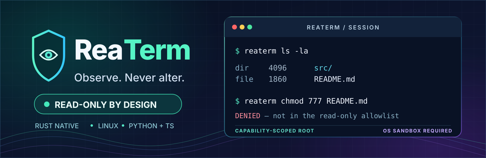

  

# ReaTerm

**Inspect files. Not everything needs a writable shell.**

> **Prototype / not independently audited.** ReaTerm is not a production
> security boundary. The optional registry packages have not been verified;
> use the source-checkout guide. Run only against a small, trusted root
> that excludes sensitive material. See the
> [threat model](docs/THREAT_MODEL.md) before exposing output to an agent.

ReaTerm is a native, read-only terminal built in Rust. Instead of allowing
arbitrary shell commands, it offers a deliberately small set of
file-inspection operations. Explore a project from the terminal,
Python, or Node.js—and give AI assistants a bounded tool for reading
information without handing them an unrestricted command runner.

**[Explore the website](https://reaterm.pro-genai.com/)** ·
**[Python](src/python/README.md)** ·
**[Node.js](src/typescript/README.md)**

## Why ReaTerm?

- **Read-only by design.** Eight built-in inspection commands, no arbitrary
  program execution, and unsupported operations denied by default.
- **Defense in depth.** Capability-scoped paths, a default deny policy for
  common secrets, bounded output, and OS-backed read-only enforcement.
  Neither a filename deny policy nor read-only execution is full DLP.
- **One-line integration.** Use `reaterm.run("ls -al")` in Python or
  `await reaterm.run("ls -al")` in JavaScript.
- **Made for AI agents.** Python function-tool definitions for OpenAI
  and Anthropic, plus a local stdio MCP server for compatible AI clients.

## Simple to use

<strong>Python</strong>

~~~python
import reaterm

print(reaterm.run("ls -al"))
print(reaterm.run('cat "README.md"'))
~~~

<strong>Node.js / TypeScript</strong>

~~~js
import * as reaterm from "reaterm";

console.log(await reaterm.run("ls -al"));
~~~

Both language adapters require the **separately installed native Rust
executable**. Registry publication is not verified; the examples describe
the source-checkout APIs, not availability on PyPI/npm.

## Get started

The native Rust executable is installed separately from the Python and
Node adapters; they do not bundle it. The recommended source-checkout
setup, platform prerequisites and examples are in the
[installation guide](docs/DEVELOPMENT.md).

## A bounded tool for AI workflows

~~~python
from reaterm.tools.openai import reaterm_tool_openai
from reaterm.tools.anthropic import reaterm_tool_anthropic

# Pass the corresponding definition in your provider's tools list.
~~~

The model requests a structured `{"command":"cat","args":["README.md"]}`
operation; your application explicitly executes it through ReaTerm and
returns the result. The convenient `run("cat README.md")` API has a
restricted quote parser, but **provider tools use separate argv tokens**;
neither interface invokes a shell. Prefer `ReaTerm.run("cat", "README.md")`
or structured provider arguments for exact filenames.

Output is untrusted project data. Files can contain instructions designed to
hijack the model, and an agent with *other* tools may transmit or act on that
data. Never grant tool output higher instruction priority or chain it into
network/action tools without independent authorization. The default
sensitive-path policy is heuristic and cannot make an arbitrary root safe.

**[See OpenAI, Anthropic & MCP examples](docs/TOOL_INTEGRATIONS.md)**

## Connect an MCP client

Use the local MCP server to offer one `run_command` inspection tool:

~~~sh
reaterm-mcp --root /absolute/path/to/project
~~~

The MCP server uses the separately installed Rust binary. The client can
request only supported read-only commands, not an arbitrary shell, and
cannot choose the directory exposed by the server. The operator chooses
that directory when starting the server.

## Small surface. Clear boundaries.

| Built-in commands | Not permitted |
| --- | --- |
| `pwd`, `ls`, `cat`, `head`, `tail`, `wc`, `grep`, `stat` | `rm`, `mv`, `cp`, shells, interpreters, arbitrary executables |

ReaTerm supports Linux x86-64/ARM64, macOS Intel/Apple Silicon, and
Windows x86-64 with platform-specific protections. It restricts **its
own process**, not the parent shell or other programs.
The selected directory is **not** a confidentiality barrier. Common
secret paths (such as `.env.production`, `.ssh/`, `.aws/`, private-key
extensions and cloud credential files) are denied by default and excluded
from `ls` output; nonstandard secret names or sensitive content in ordinary
files are not detected. The policy can also deny benign files.

Linux requires a kernel implementing **Landlock ABI v3** (roughly Linux
6.2+), plus working seccomp; older kernels fail closed. Unix native
processes have a **10-second CPU budget**, while the Python and Node
wrappers default to **15-second subprocess wall timeouts**. Neither
eliminates blocking I/O risk for a standalone CLI on unusual filesystems.
See [security limitations](docs/THREAT_MODEL.md) and
[ReaTerm versus alternatives](docs/SECURITY_HARDENING.md).

[How ReaTerm protects inspection](docs/THREAT_MODEL.md) ·
[ReaTerm website](https://reaterm.pro-genai.com/)
